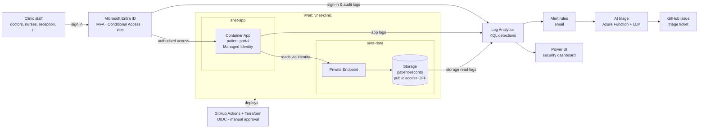

# Architecture

Every path to patient records passes identity checks and is logged.

## Components

| Component | Purpose |
|---|---|
| Entra ID | Identity for all staff; MFA, Conditional Access (Australia only), PIM for just-in-time admin |
| Container App | The clinic's patient portal; self-heals via health probe |
| Private Endpoint + Storage | Patient records reachable only from inside the VNet |
| Managed Identity | App reads storage with no keys or passwords |
| NSGs | Data subnet accepts traffic only from the app subnet |
| Log Analytics + KQL | Central logs and anomaly detection rules |
| AI triage | Turns alerts into plain-English tickets |
| Power BI | Trends and anomalies for the practice manager |
| Terraform + GitHub Actions | Repeatable, reviewed, approved deployments |

_A draw.io version will be added as `docs/architecture.png`._
